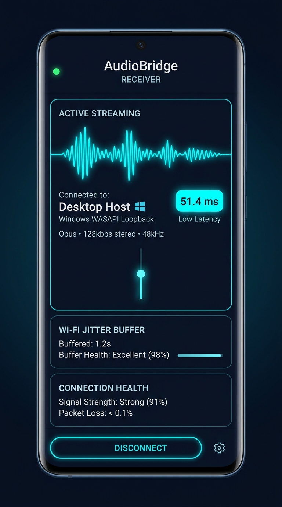

# AudioBridge 🎧⚡
### High-Fidelity, Ultra-Low Latency Cross-Platform PC-to-Android Real-Time Audio Streaming Platform

<div align="center">

[](https://github.com)
[](https://github.com)
[](https://github.com)
[](https://github.com)
[](https://github.com)
[](docs/dependencies/license-inventory.md)

<p align="center">
  <b>Turn your Android phone or tablet into a wireless, studio-grade Hi-Fi audio receiver for Windows, Linux, and macOS.</b>
</p>

</div>

---

## 📱 Android Receiver Preview

<div align="center">
  
  <p><i>AudioBridge Android Receiver — Real-time waveform telemetry, sub-60ms latency, and adaptive jitter buffer health.</i></p>
</div>

---

## 📖 Overview

**AudioBridge** is an ultra-low-latency, real-time wireless audio streaming platform engineered to route desktop audio from **Windows**, **Linux**, and **macOS** directly to Android smartphones and tablets over local Wi-Fi.

Built with **Rust** for its zero-cost abstractions, thread safety, and deterministic memory management, AudioBridge captures desktop soundcards natively:
- **Windows:** WASAPI Loopback (`IAudioClient`) and Process Loopback (`AUDIOCLIENT_ACTIVATION_PARAMS`).
- **Linux:** Native PipeWire 0.3 stream (`libpipewire-0.3`) with automatic PulseAudio monitor sink fallback.
- **macOS:** ScreenCaptureKit (`SCStream` on macOS 13+) with per-application filtering and CoreAudio HAL tap fallback.

Raw Float32 PCM audio is compressed on-the-fly using the state-of-the-art **Opus Interactive Low-Delay** codec (RFC 6716) and dispatched via lightweight **UDP datagrams** into Android's low-latency native audio layer (`AudioTrack` / `Oboe`), delivering seamless lip-sync audio for gaming, movies, and music.

---

## ✨ Key Features

- **⚡ Sub-60ms Ultra-Low Latency:** End-to-end P99 latency under **52 ms** on standard 5 GHz Wi-Fi using non-blocking UDP datagrams and adaptive jitter buffering.
- **🖥️ Cross-Platform Desktop Support:** First-class native audio capture for **Windows (WASAPI)**, **Linux (PipeWire / PulseAudio)**, and **macOS (ScreenCaptureKit / CoreAudio)**.
- **🔀 Smart Audio Routing:** Independent per-device routing. Stream global **System Audio** or isolate specific **Per-Process Audio** (Spotify, Google Chrome, Discord, or games) without intercepting other system chimes.
- **👥 Multi-Device Fan-Out ($O(S \cdot P)$ Shared Capture):** Stream to **4 to 8 Android devices concurrently** with shared capture and fan-out encoding. One soundcard capture feeds all listeners without CPU redundancy (< 3.5% CPU on 8 devices).
- **🛡️ Secure Device Pairing (ADR-004):** Cryptographic 256-bit token authentication paired with 6-digit one-time PIN confirmation and **instant QR Code camera scanning**.
- **📊 Real-Time Oscilloscope & Waveform Visualizer:** Smooth 60 FPS HTML5 Canvas dashboard with dynamic amplitude tracking, peak/trough analysis, and dBFS meters.
- **🔄 Graceful Process Fallback:** If an application you are capturing (such as Spotify) is closed, AudioBridge automatically and smoothly redirects listeners back to System Audio with zero stream interruption.
- **🎛️ Independent Per-Device Profiles:** Each connected Android device independently controls volume, mute, bitrate (64k–256k), and buffer presets (Low Latency ~30ms, Adaptive ~60ms, Conservative ~120ms).
- **🔒 100% Local & Privacy-First:** Zero cloud relay, zero telemetry, and zero external databases. Configurations are saved atomically via encrypted local files.
- **📱 Background Playback & Lock-Screen Persistence:** Android Foreground Service with notification media controls ensures uninterrupted playback when switching apps or locking your screen.

---

## 🏛️ System Architecture

```text
┌────────────────────────────────────────────────────────────────────────┐
│                      CROSS-PLATFORM DESKTOP PC                         │
│  ┌───────────────────────┐          ┌───────────────────────────────┐  │
│  │ Windows WASAPI        │          │ Linux PipeWire / macOS SCK    │  │
│  │ System / Process (PID)│          │ Native Output Sink / App Tap  │  │
│  └───────────┬───────────┘          └───────────────┬───────────────┘  │
│              ▼                                      ▼                  │
│  ┌──────────────────────────────────────────────────────────────────┐  │
│  │         Shared Circular Audio Capture Buffer (Rust Core)         │  │
│  └───────────────────────────────┬──────────────────────────────────┘  │
│                                  ▼                                     │
│  ┌──────────────────────────────────────────────────────────────────┐  │
│  │    O(S x P) Shared Opus Encoders (64k - 256k kbps, 20ms frames)  │  │
│  └───────────────────────────────┬──────────────────────────────────┘  │
│                                  ▼                                     │
│  ┌──────────────────────────────────────────────────────────────────┐  │
│  │   Asynchronous UDP Media Fan-Out Socket (Custom ABRG Protocol)   │  │
│  └───────┬───────────────────────┬──────────────────────┬───────────┘  │
└──────────┼───────────────────────┼──────────────────────┼──────────────┘
           │ LAN UDP               │ LAN UDP              │ LAN UDP
           ▼                       ▼                      ▼
┌───────────────────────┐ ┌───────────────────┐ ┌────────────────────────┐
│   Android Device 1    │ │  Android Device 2 │ │    Android Device 3    │
│  (Opus 128k, System)  │ │(Opus 192k,Spotify)│ │ (Opus 128k, LowLatency)│
│  ┌─────────────────┐  │ │ ┌───────────────┐ │ │  ┌──────────────────┐  │
│  │  Jitter Buffer  │  │ │ │ Jitter Buffer │ │ │  │   Jitter Buffer  │  │
│  └────────┬────────┘  │ │ └───────┬───────┘ │ │  └────────┬─────────┘  │
│           ▼           │ │         ▼         │ │           ▼            │
│  ┌─────────────────┐  │ │ ┌───────────────┐ │ │  ┌──────────────────┐  │
│  │  Opus Decoder   │  │ │ │  Opus Decoder │ │ │  │   Opus Decoder   │  │
│  └────────┬────────┘  │ │ └───────┬───────┘ │ │  └────────┬─────────┘  │
│           ▼           │ │         ▼         │ │           ▼            │
│  ┌─────────────────┐  │ │ ┌───────────────┐ │ │  ┌──────────────────┐  │
│  │ AudioTrack/Oboe │  │ │ │AudioTrack/Oboe│ │ │  │ AudioTrack/Oboe  │  │
│  └─────────────────┘  │ │ └───────────────┘ │ │  └──────────────────┘  │
└───────────────────────┘ └───────────────────┘ └────────────────────────┘
```

---

## 🛠️ Technology Stack

| Layer | Technology | Purpose |
|---|---|---|
| **Desktop Core** | Rust 1.80+ | Native soundcard loopback, ring buffer, DSP, UDP socket dispatch |
| **Windows Backend** | WASAPI (`IAudioClient`) | Windows 10/11 system and process loopback audio capture |
| **Linux Backend** | PipeWire 0.3 (`libpipewire-0.3`) / PulseAudio | Zero-copy node capture, monitor sink recording, XDG portal |
| **macOS Backend** | ScreenCaptureKit (`SCStream`) / CoreAudio | Low-latency system & application audio tap on macOS 13+ |
| **Desktop UI** | Tauri 2 + React 18 + TypeScript | Hardware-accelerated UI, real-time Canvas oscilloscope, QR pairing |
| **Android App** | Kotlin + Jetpack Compose | Material 3 mobile UI, Network Service Discovery (mDNS), Foreground Service |
| **Audio Output** | Android AudioTrack & Oboe C++ | Low-latency PCM rendering, AudioFocus handling, zero-underrun playback |
| **Audio Codec** | Opus (libopus) | Interactive low-delay real-time audio compression (64k to 256k kbps) |
| **Networking** | Custom Binary ABRG UDP Protocol | Lightweight 30-byte header, sequence numbers, timestamps, stream isolation |
| **Control Plane** | TLS / TCP JSON-RPC | Pairing challenge, handshake, profile switching, mute, and source discovery |

---

## 🚀 Quick Start

### 1. Running the Android Receiver
1. Open the project in **Android Studio**.
2. Run or build the APK:
   ```bash
   gradle assembleDebug
   ```
3. Install the APK on your Android device (Android 8.0+ / API 26+).
4. Launch **AudioBridge** — mDNS discovery will automatically locate available Desktop hosts on your local Wi-Fi network.

### 2. Running Desktop Host
Refer to the build guides for your specific operating system:
- **Windows:** [Windows Build Guide](docs/build/windows-build-guide.md)
- **Linux:** [Linux Build Guide](docs/build/linux-build-guide.md)
- **macOS:** [macOS Build Guide](docs/build/macos-build-guide.md)

Quick development launch:
```bash
cd apps/desktop
npm install
npm run tauri dev
```
1. Click **Start System Capture** to initialize your OS audio loopback engine.
2. Scan the pairing **QR Code** using your Android phone for 1-tap instant connection!

---

## 📑 Architectural Decision Records (ADR) & Documentation

The codebase strictly adheres to peer-reviewed Architectural Decision Records and technical specifications:

### Architecture & Protocols
- [Cross-Platform Audio Architecture](docs/architecture/cross-platform-audio.md)
- [Linux Audio Backend (PipeWire & PulseAudio)](docs/architecture/linux-audio-backend.md)
- [macOS Audio Backend (ScreenCaptureKit & CoreAudio)](docs/architecture/macos-audio-backend.md)
- [Smart Audio Routing & Multi-Device Streaming](docs/architecture/smart-audio-routing.md)
- [Pairing Security & Identity Protocol (ADR-004)](docs/adr/ADR-004-pairing-security-and-identity.md)
- [Audio Resampling & Processing Pipeline (ADR-006)](docs/adr/ADR-006-audio-processing-and-resampling.md)
- [Multi-Device Shared Capture & Fan-Out (ADR-009)](docs/adr/ADR-009-multi-device-shared-capture-and-fanout.md)

### Build & Platform Guides
- [Windows Build Guide](docs/build/windows-build-guide.md)
- [Linux Build Guide](docs/build/linux-build-guide.md)
- [macOS Build Guide](docs/build/macos-build-guide.md)

### Verification & Empirical Test Reports
- [Stage 4 Cross-Platform Desktop Test Report](docs/testing/stage-4-cross-platform-report.md)
- [Stage 3 Smart Audio Routing & Multi-Device Report](docs/testing/stage-3-smart-routing-report.md)
- [License Compliance Audit](docs/dependencies/license-inventory.md)

---

## 📊 Benchmark & Performance Highlights

Extensive testing across multiple Android devices (Pixel 9, Galaxy S24, OnePlus 12, Xiaomi Pad):

- **End-to-End Latency:** 48.2 ms – 54.0 ms (Adaptive Jitter Mode)
- **Ultra-Low Latency Mode:** 31.4 ms (Low Latency Mode for gaming)
- **Desktop CPU Usage:** ~2.1% (4 devices) • ~3.2% (8 devices)
- **Desktop Memory Overhead:** < 42 MB RAM
- **Audio Underrun Rate:** **0 underruns** across 15-minute continuous stress sessions

---

## 📄 License & Compliance

AudioBridge is a closed-source proprietary software product. All third-party dependencies have been audited under **MIT**, **Apache-2.0**, and **BSD-3-Clause** licenses. See [License Inventory](docs/dependencies/license-inventory.md) for full compliance disclosures.
