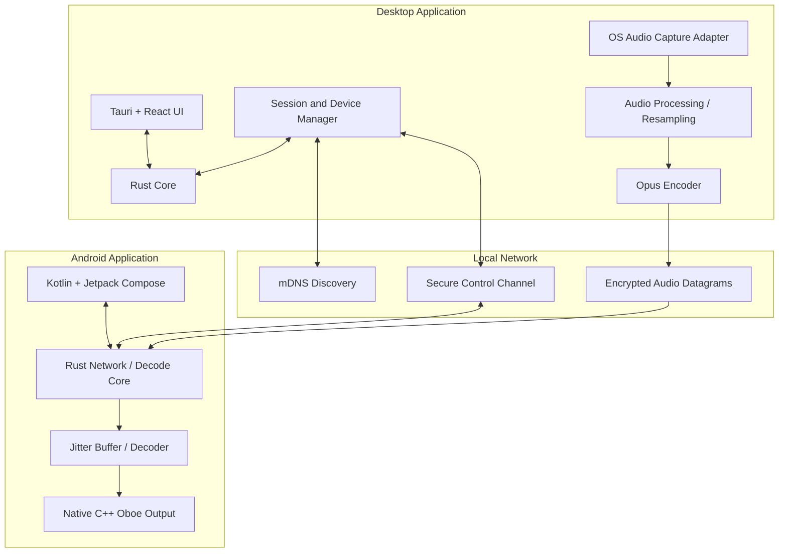
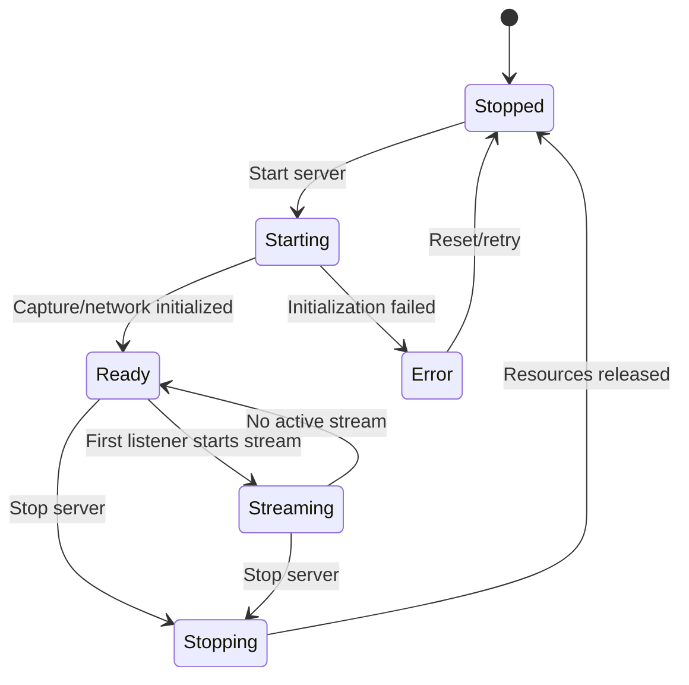
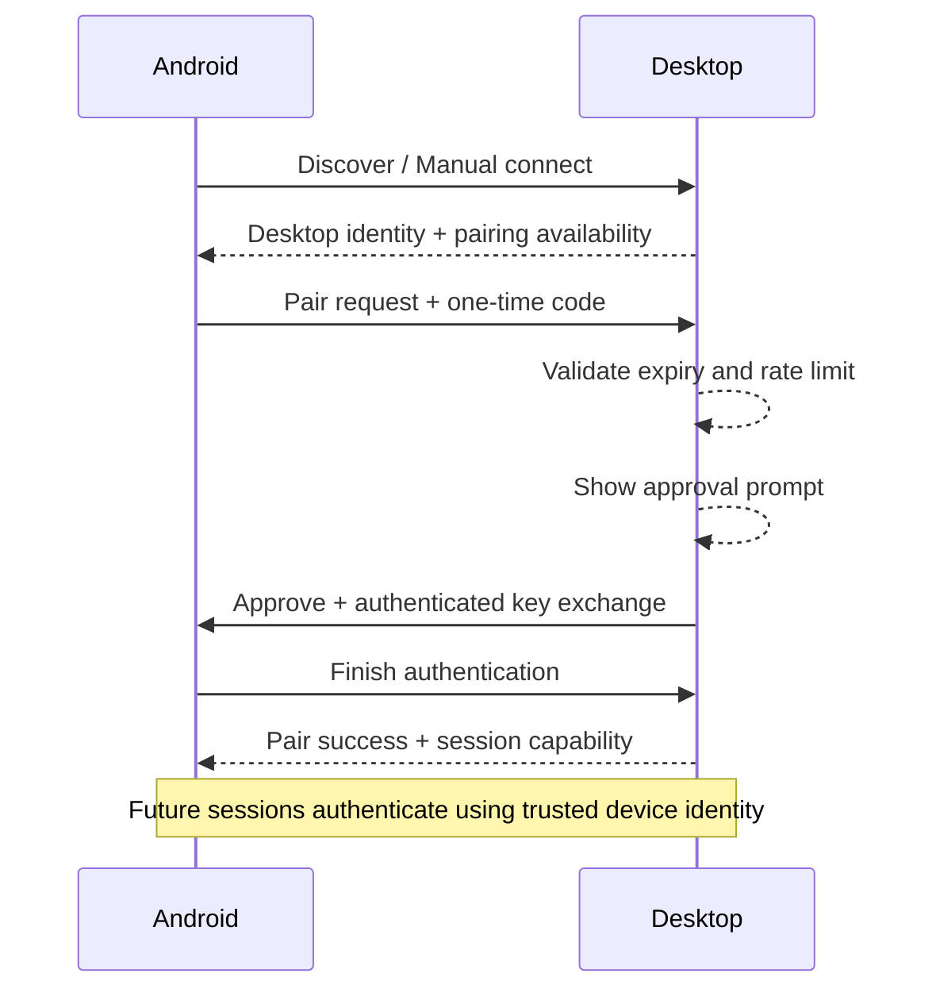
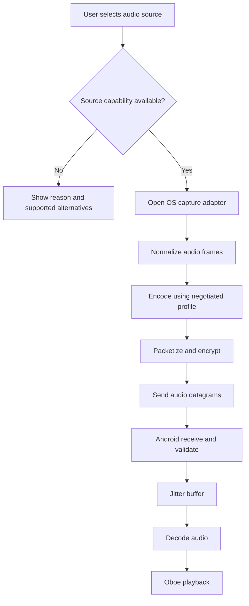
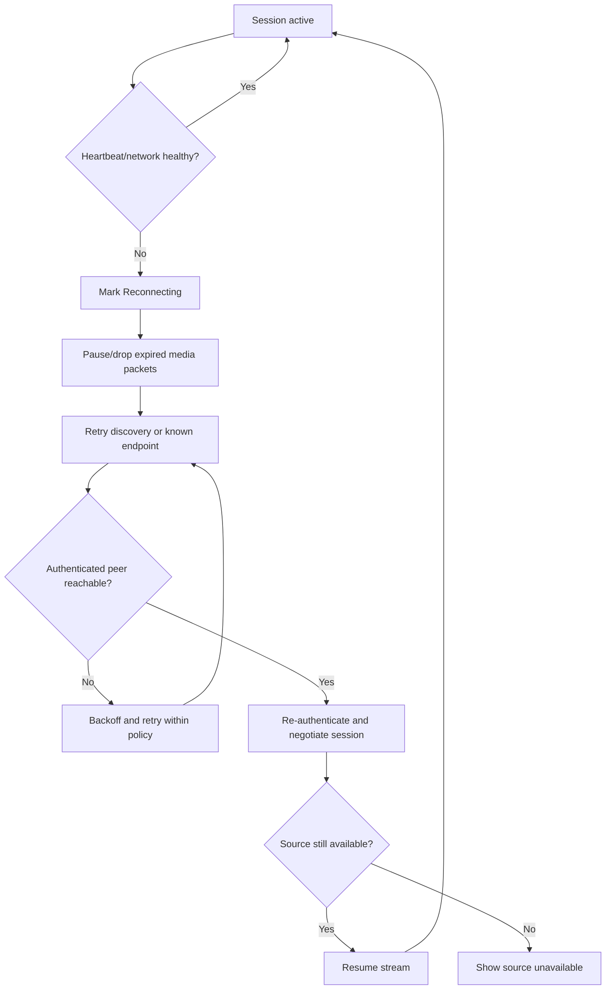
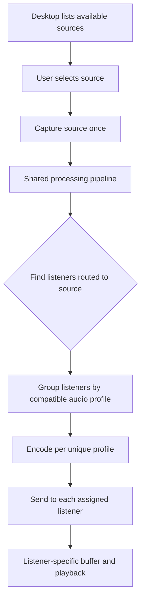

# AudioBridge — Product Requirements Document (PRD)

**Versi:** 1.0  
**Tanggal:** 4 November 2026  
**Status:** Baseline rancangan — siap untuk Technical Validation (Stage 0)  
**Nama proyek:** AudioBridge (nama kerja; dapat diganti)  
**Jenis produk:** Aplikasi PC-to-Android real-time audio streaming  
**Lisensi produk:** Proprietary / closed source  

---

## 1. Ringkasan Eksekutif

AudioBridge adalah ekosistem aplikasi yang mengirimkan audio dari komputer ke satu atau beberapa perangkat Android secara real-time melalui jaringan lokal atau koneksi kabel yang menyediakan jalur jaringan. Aplikasi terdiri dari Desktop Application sebagai audio sender dan Android Application sebagai audio receiver.

Desktop menangkap audio sistem atau sumber audio tertentu, memproses dan mengodekannya, kemudian mengirimkan paket audio ke Android. Android menerima paket, mengelola jitter/buffer, mendekode audio, lalu memutarnya melalui audio output perangkat.

Produk dikembangkan secara independen. Gemacast dan produk sejenis hanya menjadi referensi perilaku serta pembanding teknis; source code GPL atau kode proprietari pihak lain tidak boleh disalin ke implementasi proprietary AudioBridge tanpa analisis lisensi dan persetujuan yang sesuai.

### Keputusan utama

| Area | Keputusan |
|---|---|
| Pendekatan | Independent development |
| Lisensi | Closed source / proprietary |
| Desktop | Windows, Linux, macOS |
| Mobile awal | Android |
| Mobile berikutnya | iOS, di luar rilis awal |
| Desktop UI | Tauri 2 + React + TypeScript |
| Desktop/core engine | Rust |
| Android UI/lifecycle | Kotlin + Jetpack Compose |
| Android audio output | Oboe melalui native C++ |
| Integrasi Rust–Android | JNI/FFI dengan batas antarmuka yang terdokumentasi |
| Codec utama | Opus |
| Format alternatif | PCM untuk diagnostik/kompatibilitas; bukan default |
| Transport pilihan | QUIC Streams untuk control dan QUIC DATAGRAM untuk audio, menunggu validasi library dan hasil Stage 0 |
| Discovery | mDNS, dengan koneksi manual sebagai fallback |
| Penyimpanan MVP | Tanpa database; file konfigurasi dan secure storage OS |
| Mode operasional | Local-first; cloud tidak wajib |
| Fitur utama | System audio, Smart Audio Routing, multi-listener, adaptive buffer, reconnection |
| Remote internet streaming | Opsional, bukan ketergantungan MVP |

> **Catatan status teknis:** keputusan produk di atas dikunci sebagai arah proyek. Namun transport final, latensi aktual, kompatibilitas OS, dan pembagian kerja native/Rust harus dibuktikan melalui Stage 0. PRD ini tidak menganggap target performa sebagai jaminan sebelum diuji.

## 2. Latar Belakang dan Masalah

Pengguna ingin mendengarkan keluaran audio komputer melalui speaker atau headphone yang terhubung ke perangkat Android, tanpa harus memindahkan file audio secara manual. Solusi harus terasa seperti sistem audio nirkabel: pengguna memilih PC, memasangkan perangkat, memilih sumber audio, lalu mendengarkan audio dengan jeda rendah dan koneksi yang stabil.

Kebutuhan lanjutan mencakup pemilihan audio per aplikasi, beberapa Android yang tersambung secara bersamaan, serta pengaturan kualitas dan buffer berbeda untuk tiap perangkat.

## 3. Visi Produk dan Nilai Utama

**Visi:** menjadi sistem audio receiver lokal yang ringan, aman, lintas platform desktop, dan dapat dikembangkan tanpa bergantung pada server cloud.

Nilai utama:
1. **Low latency:** audio dikirim dengan jeda serendah mungkin tanpa mengorbankan kestabilan secara tidak realistis.
2. **Reliability:** mampu memulihkan koneksi dan menangani jitter maupun packet loss.
3. **Local-first privacy:** audio tidak dikirim ke cloud secara default.
4. **Flexible routing:** sumber audio dapat dipilih untuk setiap perangkat penerima.
5. **Cross-platform architecture:** satu core yang dapat digunakan ulang, dengan adapter native sesuai kemampuan OS.

## 4. Tujuan, Bukan Tujuan, dan Batasan

### 4.1 Tujuan produk

- Mengirim system audio dari desktop ke Android pada jaringan lokal.
- Memasangkan desktop dan Android dengan persetujuan pengguna.
- Memutar audio ketika aplikasi Android berada di foreground maupun background, sesuai aturan OS.
- Menyediakan pengaturan codec, bitrate, sample rate, channel, dan buffer.
- Menampilkan status streaming dan metrik diagnostik.
- Mendukung lebih dari satu Android pada rilis produk matang.
- Mendukung routing audio independen per perangkat.
- Menyediakan implementasi desktop untuk Windows, Linux, dan macOS.

### 4.2 Bukan tujuan MVP

- Streaming melalui internet/public relay.
- Akun pengguna, sinkronisasi cloud, atau backend SaaS.
- Rekaman audio permanen.
- Voice chat, mikrofon balik, atau panggilan dua arah.
- Video/screen mirroring.
- Equalizer/DSP profesional yang kompleks.
- Aplikasi iOS pada rilis awal.
- Menjamin capture dari semua aplikasi yang dilindungi DRM atau dibatasi OS.

### 4.3 Batasan penting

- Audio per aplikasi tidak memiliki kemampuan dan izin yang seragam di semua OS.
- Beberapa konten yang dilindungi DRM dapat membatasi atau mencegah capture.
- Kualitas akhir dipengaruhi hardware audio, driver, jaringan, Android, dan kebijakan battery management vendor.
- USB Tethering dan ADB adalah dua metode berbeda yang memerlukan adapter koneksi tersendiri. Keduanya bukan USB audio transport langsung.

## 5. Pengguna dan Skenario Penggunaan

### Persona utama

Pengguna komputer yang ingin memindahkan output audio PC ke HP Android, headphone Bluetooth yang terhubung ke HP, atau speaker eksternal yang terhubung ke HP.

### Skenario utama

1. Pengguna menginstal AudioBridge Desktop dan AudioBridge Android.
2. Kedua perangkat berada pada jaringan lokal yang sama.
3. Desktop menjalankan server lokal dan menampilkan kode pairing.
4. Android menemukan desktop melalui discovery atau pengguna memasukkan alamat secara manual.
5. Pengguna menyetujui pairing pada desktop.
6. Android memilih sumber audio dan profil kualitas.
7. Desktop menangkap, memproses, mengodekan, dan mengirim audio.
8. Android mendekode dan memutar audio.
9. Pengguna memantau kualitas koneksi dan dapat mengganti routing atau menghentikan sesi.

### Skenario lanjutan

- Beberapa HP tersambung ke satu desktop.
- HP A menerima Chrome, HP B menerima Discord, HP C menerima system audio.
- Satu source digunakan oleh beberapa HP.
- Jaringan terputus dan perangkat mencoba reconnect.
- Pengguna menghubungkan PC dan HP menggunakan USB Tethering atau ADB tunnel.

## 6. Ruang Lingkup dan Prioritas Fitur

Prioritas:
- **P0:** harus tersedia untuk MVP.
- **P1:** fitur utama setelah MVP dan harus tersedia sebelum rilis fitur lengkap.
- **P2:** ekspansi platform/konektivitas.
- **P3:** pengembangan masa depan.

| ID | Fitur | Prioritas | Deskripsi |
|---|---|---:|---|
| FR-001 | Desktop local server | P0 | Menjalankan dan menghentikan service streaming lokal |
| FR-002 | Android discovery | P0 | Menemukan desktop pada LAN melalui mDNS |
| FR-003 | Manual connection | P0 | Menghubungkan menggunakan alamat/port jika discovery gagal |
| FR-004 | Secure pairing | P0 | Kode sekali pakai, persetujuan desktop, identitas perangkat |
| FR-005 | System audio capture | P0 | Menangkap output audio sistem pada Windows awal |
| FR-006 | Audio encoding | P0 | Mengodekan audio menggunakan Opus |
| FR-007 | Audio streaming | P0 | Mengirim audio secara real-time melalui LAN |
| FR-008 | Android playback | P0 | Memutar audio melalui output Android |
| FR-009 | Background playback | P0 | Streaming tetap berjalan ketika UI tidak di depan, sesuai kebijakan OS |
| FR-010 | Basic audio settings | P0 | Codec, bitrate, sample rate, channel, buffer preset |
| FR-011 | Connection status | P0 | Menampilkan Connected, Streaming, Reconnecting, Disconnected |
| FR-012 | Basic diagnostics | P0 | Menampilkan bitrate aktual, estimasi latency, jitter, packet loss, buffer |
| FR-013 | Auto reconnect | P0 | Mencoba menyambung kembali setelah gangguan sementara |
| FR-014 | Session stop/release | P0 | Menghentikan capture, jaringan, dan audio output dengan aman |
| FR-015 | Per-process capture | P1 | Menangkap audio dari aplikasi/proses tertentu jika OS mendukung |
| FR-016 | Audio source list | P1 | Menampilkan sumber audio yang tersedia |
| FR-017 | Smart Audio Routing | P1 | Memetakan source ke listener secara independen |
| FR-018 | Multi-listener | P1 | Melayani minimal 4 Android sebagai target pengujian awal |
| FR-019 | Per-device profile | P1 | Profil audio terpisah per Android |
| FR-020 | Adaptive buffer | P1 | Menyesuaikan buffer berdasarkan jitter dan kondisi jaringan |
| FR-021 | Packet-loss handling | P1 | Packet loss concealment dan/atau FEC sesuai hasil uji |
| FR-022 | Device management | P1 | Melihat, mengganti nama, memutus, dan mencabut perangkat tepercaya |
| FR-023 | USB Tethering | P2 | Menggunakan koneksi jaringan yang dibawa melalui USB |
| FR-024 | ADB tunnel | P2 | Membuat jalur jaringan melalui Android Debug Bridge |
| FR-025 | Linux capture | P2 | Adapter capture berbasis PipeWire |
| FR-026 | macOS capture | P2 | Adapter capture berbasis ScreenCaptureKit |
| FR-027 | Remote streaming | P3 | Streaming di luar LAN, harus melalui desain keamanan tersendiri |
| FR-028 | iOS receiver | P3 | Receiver mobile untuk platform iOS |

**Catatan scope:** MVP pertama hanya membuktikan satu desktop Windows ke satu Android melalui LAN. Multi-listener dan Smart Audio Routing tetap menjadi persyaratan produk, tetapi masuk setelah jalur single-listener terbukti stabil.

## 7. Kebutuhan Fungsional Terperinci

### 7.1 Desktop Application

- Dashboard menampilkan status server, alamat/port lokal, dan status audio engine.
- Tombol Start Server dan Stop Server.
- Menampilkan perangkat ditemukan/terpasang, perangkat tepercaya, dan perangkat aktif.
- Menampilkan daftar audio source sesuai kemampuan adapter OS.
- Memungkinkan pengguna memilih System Audio atau sumber aplikasi tertentu.
- Menyediakan pengaturan codec dan profil kualitas.
- Menampilkan metrik sesi dan diagnostik.
- Menampilkan indikator capture aktif yang selalu terlihat.
- Menyediakan tombol disconnect/revoke untuk tiap perangkat.
- Service berhenti dengan aman ketika aplikasi ditutup atau pengguna menekan Stop.

### 7.2 Android Application

- Beranda menampilkan desktop yang ditemukan dan perangkat tersimpan.
- Koneksi manual tersedia sebagai fallback.
- Menampilkan detail desktop dan permintaan pairing.
- Memilih audio source yang ditawarkan desktop.
- Memilih profil kualitas atau pengaturan lanjutan sesuai hak yang disediakan desktop.
- Menampilkan status streaming, bitrate, latency estimasi, jitter, packet loss, dan buffer.
- Menyediakan kontrol Start, Pause/Stop, Reconnect, dan Disconnect.
- Streaming dapat berjalan di background menggunakan foreground service yang sesuai.
- Menampilkan notifikasi persisten selama playback background.
- Pengguna dapat menghapus desktop tepercaya.

### 7.3 Discovery dan Pairing

- Discovery hanya berlaku pada jaringan yang dapat dijangkau multicast/mDNS.
- Jika discovery tidak berfungsi karena router/VLAN/firewall, pengguna dapat memasukkan IP/hostname dan port secara manual.
- Pairing menggunakan kode sementara (contoh enam digit) dan persetujuan eksplisit pada desktop.
- Kode memiliki masa berlaku, batas percobaan, dan tidak boleh digunakan ulang.
- Setelah pairing, perangkat menggunakan identitas/kunci kriptografis yang disimpan aman.
- Pengguna dapat revoke identitas perangkat kapan saja.
- Kode pairing tidak menjadi satu-satunya dasar keamanan sesi permanen.

### 7.4 Audio Capture

- P0: system audio capture pada Windows.
- P1: process/application capture pada Windows setelah validasi OS API.
- P2: PipeWire pada Linux dan ScreenCaptureKit pada macOS.
- Aplikasi mendeteksi capability OS dan hanya menampilkan opsi yang benar-benar tersedia.
- Capture harus berhenti ketika sesi dihentikan, izin dicabut, atau sumber tidak tersedia.
- Aplikasi tidak boleh mencoba melewati proteksi DRM atau pembatasan sistem.

### 7.5 Smart Audio Routing

- Desktop mempertahankan satu capture pipeline per source yang aktif, bukan satu capture per listener.
- Setiap listener dapat memilih source sendiri.
- Satu source dapat dibagikan ke beberapa listener.
- Setiap listener mempunyai konfigurasi bitrate/buffer sendiri.
- Encoder dapat dibagikan untuk listener dengan profil codec yang identik; profil berbeda dapat membutuhkan encoder terpisah.
- Perubahan routing tidak boleh menghentikan sesi perangkat lain yang tidak terdampak.

### 7.6 Multi-listener

- Rilis fitur lengkap menargetkan minimal empat listener simultan.
- Pengujian skalabilitas dilakukan sampai delapan listener sebagai target uji, bukan jaminan dukungan final.
- Listener yang disconnect tidak boleh mematikan session listener lain.
- Desktop menampilkan penggunaan bandwidth dan jumlah stream aktif.
- Batas listener dapat dikonfigurasi berdasarkan hasil benchmark dan kemampuan hardware.

## 8. UI/UX dan Halaman

### 8.1 Desktop

1. **Dashboard:** server state, source aktif, perangkat aktif, metrik singkat.
2. **Audio Sources:** system audio dan daftar aplikasi/sumber yang tersedia.
3. **Devices:** perangkat ditemukan, tepercaya, terhubung, dan tombol revoke.
4. **Routing:** tabel source → listener.
5. **Audio Settings:** codec, bitrate, sample rate, channel, buffer, advanced settings.
6. **Diagnostics:** latency, jitter, loss, throughput, buffer, error log.
7. **General Settings:** startup behavior, network interface, log level, privacy.

### 8.2 Android

1. **Home/Discovery:** desktop yang ditemukan dan koneksi manual.
2. **Pairing:** kode, identitas desktop, konfirmasi persetujuan.
3. **Receiver:** source aktif, playback control, kualitas, status koneksi.
4. **Audio Settings:** preset dan pengaturan lanjutan.
5. **Diagnostics:** metrik streaming dan bantuan troubleshooting.
6. **Trusted PCs:** daftar desktop tersimpan dan remove/revoke.

### 8.3 Prinsip desain

- UI bersih, ringan, konsisten, dan tidak penuh metrik pada layar utama.
- Status koneksi harus mudah dikenali.
- Fitur lanjutan dapat diletakkan di Advanced Settings.
- Menjelaskan izin OS sebelum membuka dialog sistem.
- Kesalahan harus menyertakan sebab yang dapat diketahui dan tindakan pemulihan.

## 9. Arsitektur Sistem

### 9.1 Diagram tingkat tinggi



### 9.2 Desktop layer

- Tauri 2 + React + TypeScript: UI dan interaksi pengguna.
- Rust application core: lifecycle server, sesi, konfigurasi, routing, dan orkestrasi.
- OS capture adapters: implementasi API khusus Windows/Linux/macOS.
- Audio processing: normalisasi format, resampling, channel mapping, mixing bila diperlukan.
- Opus encoder: encoding per profil stream.
- Network layer: discovery, control, dan media transport.

### 9.3 Android layer

- Kotlin + Jetpack Compose: UI, permissions, lifecycle, device management.
- Foreground Service: mempertahankan sesi playback background sesuai kebijakan Android.
- Rust core: network protocol, authentication, jitter buffer, dan decoding bila library serta ABI mendukung.
- C++ Oboe: native audio output.
- JNI/FFI: antarmuka Kotlin/Java ↔ C++ ↔ Rust yang sempit, stabil, dan terdokumentasi.

Oboe adalah library native C++; Oboe bukan API Rust. Oleh karena itu, integrasi native harus menjadi bagian eksplisit desain Android.

### 9.4 Shared Core

Rust crates yang direncanakan:

```text
crates/
  audio-types/          # Format, timestamp, stream metadata
  audio-processing/     # Resampling, channel mapping, mixing
  audio-codec/          # Opus wrapper dan codec negotiation
  audio-buffer/         # Jitter buffer dan queue
  audio-routing/        # Source-to-listener mapping
  streaming-protocol/   # Pesan control dan media header
  networking/           # Transport dan discovery
  pairing-security/     # Pairing, identity, authentication
  session-manager/      # Session lifecycle
  config/               # Model konfigurasi dan validasi
  diagnostics/          # Metrics dan structured logs
```

Native adapters:

```text
platform/
  windows/              # WASAPI adapters
  linux/                # PipeWire adapters
  macos/                # ScreenCaptureKit adapters
  android/              # JNI/FFI dan Oboe integration
```

## 10. Platform dan Kompatibilitas

| Platform | Target | Capture approach | Catatan |
|---|---|---|---|
| Windows | MVP pertama; Windows 10/11 yang diuji | WASAPI loopback | Process loopback memiliki persyaratan build OS tersendiri |
| Linux | Rilis lintas platform | PipeWire | Bergantung pada sesi PipeWire, permission, dan desktop environment |
| macOS | Rilis lintas platform | ScreenCaptureKit | Perlu izin Screen & System Audio Recording |
| Android | MVP dan rilis awal | Rust receiver + Oboe output | Minimum API awal direncanakan 27; validasi perangkat diperlukan |
| iOS | Masa depan | Belum ditentukan | Di luar scope PRD rilis awal |

### 10.1 Capability Detection

Setiap adapter harus melaporkan kemampuan secara runtime, minimal:
- system audio capture tersedia/tidak;
- application/process capture tersedia/tidak;
- daftar source yang dapat dipilih;
- sample rate dan channel yang didukung;
- izin yang dibutuhkan dan status izin;
- alasan jika kemampuan tidak tersedia.

UI tidak boleh menampilkan source yang tidak dapat digunakan.

### 10.2 Android background playback

Android harus menggunakan foreground service dengan tipe dan permission yang sesuai untuk media playback. Persyaratan manifest dan distribusi harus diperiksa ulang terhadap target SDK pada saat rilis. Pada Android 14+, service type yang sesuai wajib dideklarasikan. Dokumentasi Android menyebut `mediaPlayback` sebagai tipe untuk melanjutkan pemutaran audio/video dari background.

## 11. Audio Pipeline dan Konfigurasi

### 11.1 Pipeline

```text
OS Audio Source
   -> Capture Callback
   -> Audio Format Normalization
   -> Resampling / Channel Mapping
   -> Optional Mixing / Processing
   -> Frame Assembly
   -> Opus Encoder
   -> Packetization
   -> Secure Transport
   -> Android Receive Queue
   -> Jitter Buffer
   -> Opus Decoder
   -> Oboe Output Callback
   -> Speaker / Headphone
```

Callback real-time harus singkat, tidak melakukan blocking I/O, tidak mengalokasikan memori berlebihan, dan tidak menjalankan pekerjaan yang tidak terbatas.

### 11.2 Nilai awal untuk eksperimen

| Parameter | Nilai awal | Catatan |
|---|---:|---|
| Codec | Opus | Default utama |
| Sample rate | 48 kHz | Dinegosiasikan dengan source/output |
| Channel | Stereo | Mono tersedia |
| Frame duration | 20 ms | Dibandingkan dengan 10 ms saat validation |
| Bitrate | 128 kbps | Preset Normal |
| Preset Low | 64 kbps | Untuk bandwidth rendah |
| Preset High | 192 kbps | Kualitas lebih tinggi |
| Preset Very High | 256 kbps | Perlu benchmark bandwidth/CPU |
| Buffer | Adaptive | Starting point diuji; bukan angka tetap universal |
| PCM | Alternatif | Untuk debugging/kompatibilitas, bandwidth lebih besar |

Nilai tersebut adalah konfigurasi awal untuk eksperimen dan boleh berubah berdasarkan hasil pengujian codec, jaringan, dan perangkat.

### 11.3 Buffer dan packet loss

- Jitter buffer harus dapat menyesuaikan kondisi jaringan dengan batas minimum dan maksimum.
- Paket yang terlambat melewati deadline playback dibuang, bukan menambah latensi dengan retransmission audio yang sudah tidak berguna.
- Decoder harus menangani kehilangan frame menggunakan packet-loss concealment jika didukung codec.
- FEC dapat diaktifkan jika hasil benchmark menunjukkan manfaat untuk kondisi jaringan yang diuji.
- Adaptive buffer tidak boleh terus membesar sehingga menyebabkan latensi menumpuk.

## 12. Protokol Jaringan

### 12.1 Komunikasi dipisah menjadi dua bidang

**Control plane (andal):** discovery metadata, pairing, source list, routing, konfigurasi, start/stop, keepalive, error, dan status.

**Media plane (real-time):** paket audio dengan sequence number, timestamp, stream ID, codec/profile ID, dan payload.

### 12.2 Transport pilihan

Kandidat utama adalah QUIC:
- QUIC Streams untuk control messages yang memerlukan urutan dan reliabilitas.
- QUIC DATAGRAM untuk frame audio real-time yang tidak boleh menambah latensi karena retransmission.
- QUIC menyediakan keamanan koneksi; tetap perlu verifikasi fingerprint/identitas peer dan kebijakan pairing aplikasi.

RFC 9221 mendefinisikan QUIC DATAGRAM sebagai datagram yang tidak memerlukan retransmission dan dapat berbagi konteks keamanan dengan stream QUIC. Namun dukungan library lintas desktop/Android dan batas ukuran datagram harus dibuktikan di Stage 0.

**Fallback yang boleh dipilih setelah benchmark:** control melalui TLS/TCP dan media melalui UDP yang diamankan dengan protokol/library standar seperti DTLS atau AEAD yang dirancang secara benar. Dilarang membuat algoritma kriptografi sendiri. Fallback harus ditetapkan dalam Architecture Decision Record (ADR).

### 12.3 Discovery

- mDNS digunakan untuk menemukan desktop pada satu LAN yang mendukung multicast.
- Discovery bukan satu-satunya cara koneksi.
- Manual IP/hostname + port tersedia sebagai fallback.
- Discovery tidak diasumsikan bekerja melewati VLAN, guest Wi-Fi isolation, VPN, atau subnet berbeda.

### 12.4 Audio packet metadata minimum

- protocol_version;
- session_id;
- stream_id;
- sequence_number;
- media_timestamp;
- codec/profile_id;
- payload_length atau framing yang tidak ambigu;
- audio payload.

Field persis dan ukuran header ditentukan pada dokumen protocol specification setelah Stage 0. Semua input jaringan harus divalidasi dan ukuran paket dibatasi.

### 12.5 Control messages minimum

`HELLO`, `PAIR_REQUEST`, `PAIR_APPROVED`, `PAIR_REJECTED`, `AUTHENTICATE`, `GET_SOURCES`, `SOURCE_LIST`, `SELECT_SOURCE`, `SET_AUDIO_PROFILE`, `START_STREAM`, `STOP_STREAM`, `STREAM_STATUS`, `METRICS`, `PING`, `PONG`, `RECONNECT`, `REVOKE_DEVICE`, `ERROR`.

Control protocol harus memiliki versi, schema validation, error code stabil, dan kompatibilitas versi yang jelas.

## 13. Smart Audio Routing dan Multi-listener

### 13.1 Domain model

```text
AudioSource
  - source_id
  - display_name
  - source_type (system/process/application)
  - capability_status
  - native_source_reference (runtime only)

ListenerDevice
  - device_id
  - display_name
  - trust_status
  - connection_status

AudioRoute
  - route_id
  - source_id
  - listener_device_id
  - audio_profile_id
  - route_status

AudioProfile
  - profile_id
  - codec
  - bitrate
  - sample_rate
  - channels
  - frame_duration
  - buffer_mode
```

Entitas di atas adalah model domain, bukan berarti harus disimpan dalam database. Sesi dan route aktif berada di RAM. Preferensi persisten disimpan lokal.

### 13.2 Aturan routing

- Satu listener dapat memilih satu source aktif pada satu waktu untuk MVP routing awal.
- Satu source dapat dikirim ke banyak listener.
- Beberapa source dapat dicapture secara bersamaan jika OS mendukung.
- Mixing beberapa source menjadi satu output dapat ditambahkan sebagai fitur lanjutan, tetapi harus didefinisikan terpisah dari routing satu-source-per-listener.
- Source capture dibagi bersama; encoding dapat dibagikan untuk profil identik.
- Gangguan satu listener tidak boleh merusak stream listener lain.

## 14. Security, Privacy, dan Trust

- Pairing membutuhkan persetujuan eksplisit desktop.
- Kode pairing bersifat sementara, sekali pakai, kedaluwarsa, dan dibatasi percobaannya.
- Setelah pairing, perangkat memakai identitas kriptografis persisten.
- Gunakan library keamanan yang teruji; tidak boleh membuat kriptografi sendiri.
- Simpan private key menggunakan OS credential/secure storage. Android menggunakan Android Keystore untuk material kunci yang sesuai.
- Simpan metadata perangkat tepercaya tanpa menyimpan secret dalam file konfigurasi biasa.
- Semua control dan media traffic harus terenkripsi serta terautentikasi.
- Tidak ada cloud upload audio secara default.
- Tidak ada perekaman audio otomatis.
- Indikator capture aktif harus tampak di desktop.
- Pengguna dapat menghentikan capture dan mencabut kepercayaan perangkat.
- Log tidak boleh mencatat payload audio, private key, kode pairing aktif, atau data sensitif.
- Batasi ukuran pesan, jumlah koneksi, dan resource yang dialokasikan dari input peer.

## 15. Penyimpanan dan Konfigurasi — Tanpa Database MVP

Database tidak dibutuhkan untuk MVP. AudioBridge bukan aplikasi transaksi dan tidak membutuhkan query relasional untuk alur utamanya.

| Platform | Penyimpanan | Konten |
|---|---|---|
| Desktop | JSON/TOML | Preferensi, audio profile, pengaturan jaringan |
| Desktop | OS Credential Store | Secret/credential dan identitas privat |
| Android | Jetpack DataStore | Preferensi, daftar desktop dan profile metadata |
| Android | Android Keystore | Kunci kriptografis |
| Semua | RAM | Sesi aktif, buffer, routing aktif, metrics sementara |

Aturan:
- File konfigurasi harus memiliki `schema_version` dan migrasi sederhana.
- Penulisan konfigurasi harus atomik agar file tidak rusak saat aplikasi crash.
- Secret tidak boleh dimasukkan ke JSON/TOML biasa.
- Penghapusan perangkat tepercaya harus menghapus metadata dan key terkait.
- SQLite hanya dipertimbangkan jika kelak ada kebutuhan nyata seperti histori besar, preset kompleks, atau analytics lokal. Penambahan database tidak boleh menjadi prasyarat streaming.

Contoh konfigurasi non-secret:

```json
{
  "schema_version": 1,
  "audio": {
    "codec": "opus",
    "sample_rate": 48000,
    "channels": 2,
    "bitrate_kbps": 128,
    "frame_duration_ms": 20,
    "buffer_mode": "adaptive"
  },
  "network": {
    "discovery_enabled": true,
    "manual_port": null
  },
  "privacy": {
    "allow_remote_streaming": false,
    "save_audio_recordings": false
  }
}
```

## 16. State dan Flow Sistem

### 16.1 Desktop server lifecycle



### 16.2 Pairing flow



### 16.3 Streaming flow



### 16.4 Reconnect flow



### 16.5 Smart Audio Routing flow



## 17. Non-Functional Requirements (NFR)

| ID | Requirement | Target / kriteria |
|---|---|---|
| NFR-001 | Latensi | Eksperimen awal menargetkan 50–100 ms pada LAN yang terkontrol; ukur p50/p95 end-to-end, bukan hanya network latency |
| NFR-002 | Stability | Uji streaming 30 menit tanpa crash pada kondisi LAN normal |
| NFR-003 | Packet loss | Jitter buffer dan concealment harus menjaga playback saat loss terukur; batas akhir ditetapkan benchmark |
| NFR-004 | Reconnection | Memulai retry otomatis setelah koneksi hilang; backoff terbatas dan status terlihat |
| NFR-005 | Multi-listener | Minimal 4 listener simultan sebagai target rilis fitur lengkap |
| NFR-006 | Resource | CPU, RAM, dan bandwidth dicatat untuk baseline; target numerik ditetapkan dari perangkat uji |
| NFR-007 | Privacy | Tidak ada audio cloud atau recording otomatis |
| NFR-008 | Security | Authenticated encryption, pairing approval, key storage aman |
| NFR-009 | Maintainability | Adapter OS terpisah; core dan protocol berversi |
| NFR-010 | Compatibility | Capability detection dan test matrix per OS |
| NFR-011 | Accessibility | Status tidak hanya dibedakan melalui warna; label dan kontras yang cukup |
| NFR-012 | Observability | Structured logs dan metrics tanpa merekam payload audio atau secret |

Latensi end-to-end harus diukur dari waktu capture sampel di desktop hingga sampel terkait keluar dari audio output Android. Target 50–100 ms adalah target optimasi dalam kondisi jaringan dan perangkat yang baik, bukan SLA universal.

## 18. Diagnostics dan Troubleshooting

Metrik yang ditampilkan:
- bitrate target dan bitrate aktual;
- end-to-end latency estimasi/hasil pengukuran;
- network RTT untuk control channel;
- jitter;
- packet loss/late packet;
- jitter buffer level;
- decoder error/underrun;
- audio output underrun;
- network throughput;
- CPU/RAM bila tersedia;
- koneksi aktif dan umur sesi.

Log harus memiliki level `error`, `warn`, `info`, dan `debug`. Pengguna dapat mengekspor diagnostic bundle yang menyertakan versi aplikasi, OS, adapter, konfigurasi non-secret, dan log terfilter. Diagnostic bundle tidak menyertakan audio mentah, private key, token, atau kode pairing.

## 19. Acceptance Criteria

### MVP P0

- **AC-001:** Desktop Windows dapat memulai dan menghentikan server lokal tanpa meninggalkan proses capture/network yang berjalan.
- **AC-002:** Android dapat menemukan desktop melalui mDNS pada LAN yang mendukungnya, dan dapat tersambung dengan manual IP jika discovery gagal.
- **AC-003:** Pairing memerlukan approval desktop dan kode yang kedaluwarsa serta dibatasi percobaannya.
- **AC-004:** Desktop menangkap system audio Windows dan Android menerima audio yang dapat didengar.
- **AC-005:** Audio berjalan minimal 30 menit pada test LAN normal tanpa crash aplikasi.
- **AC-006:** Android tetap memutar audio saat UI masuk background dan menampilkan notifikasi service yang sesuai.
- **AC-007:** Pengguna dapat memilih preset bitrate dan buffer tanpa restart penuh aplikasi, sepanjang perubahan didukung sesi.
- **AC-008:** UI menampilkan status connection/streaming/reconnecting/disconnected.
- **AC-009:** Audio dihentikan ketika pengguna menekan Stop atau sesi dibatalkan.
- **AC-010:** Tidak ada konten audio atau secret yang tersimpan di log.

### P1

- **AC-101:** Desktop menampilkan daftar sumber aplikasi yang didukung oleh adapter OS.
- **AC-102:** Listener dapat memilih source sesuai routing yang diizinkan.
- **AC-103:** Satu source dapat dikirim ke beberapa listener.
- **AC-104:** Putusnya satu listener tidak menghentikan listener lain.
- **AC-105:** Empat listener dapat diuji secara bersamaan pada baseline hardware yang didokumentasikan.
- **AC-106:** Per-device profile tersimpan dan dipakai kembali.
- **AC-107:** Adaptive buffer dapat menyesuaikan jitter tanpa pertumbuhan latensi yang tidak terbatas.

### P2

- **AC-201:** Linux PipeWire adapter melewati test capture system pada distribusi yang masuk test matrix.
- **AC-202:** macOS ScreenCaptureKit adapter berjalan setelah izin diberikan dan menampilkan kondisi izin dengan benar.
- **AC-203:** USB Tethering dan ADB tunnel dapat dipilih sebagai network path yang terpisah dan didiagnosis.

## 20. Technical Validation — Stage 0 (Gerbang Sebelum MVP)

Stage 0 adalah rangkaian eksperimen teknis kecil. Jangan mulai membangun semua UI dan modul sebelum eksperimen ini lulus.

### Eksperimen

1. Windows WASAPI loopback → PCM frames.
2. PCM frames → Opus encode/decode → audio test output.
3. Desktop → Android melalui LAN dengan audio packet transport.
4. Android Rust/native bridge → Oboe output.
5. Pengukuran latensi end-to-end menggunakan metode loopback/rekaman pengujian tersinkronisasi.
6. Pengujian reconnect ketika Wi-Fi mati/hidup.
7. Benchmark pilihan QUIC DATAGRAM library pada target desktop dan Android.
8. Verifikasi lisensi seluruh dependency dan kemampuan packaging closed-source.

### Gate Stage 0

Stage 0 dinyatakan lulus jika:
- satu PC Windows berhasil mengirim system audio ke satu Android;
- streaming berjalan minimal 10 menit pada jaringan pengujian tanpa crash;
- kualitas suara dapat diterima dan tidak terjadi underrun berulang;
- metrik latency/jitter/loss dapat dikumpulkan;
- integrasi Rust dengan Android audio output dapat dibangun ulang dari dokumentasi;
- transport dan dependency terpilih memiliki lisensi yang kompatibel dengan produk proprietary.

Jika QUIC DATAGRAM belum layak secara teknis atau library lintas platform tidak memadai, buat ADR untuk memilih fallback yang aman. Jangan menulis protokol kriptografi sendiri.

## 21. Roadmap Pembangunan

| Stage | Fokus | Deliverable / exit gate |
|---|---|---|
| 0 | Technical validation | Prototype Windows → Android berhasil, benchmark awal, keputusan transport dan lisensi |
| 1 | Core MVP | System audio, pairing, LAN streaming, Android playback, basic settings, diagnostics |
| 2 | Audio management | Source list, application capture awal, codec/profile, adaptive buffer |
| 3 | Multi-device | Multi-listener, independent routing, per-device profile, isolation |
| 4 | Cross-platform desktop | Linux PipeWire dan macOS ScreenCaptureKit adapters |
| 5 | Advanced connectivity | USB Tethering, ADB tunnel, optimasi dan hardening |
| 6 | Release | Test matrix, installer, signing, dokumentasi, release channel |

Tahapan tidak dijanjikan berdasarkan tanggal kalender. Setiap stage dimulai setelah acceptance criteria stage sebelumnya terpenuhi.

## 22. Struktur Repository yang Disarankan

```text
audiobridge/
├── apps/
│   ├── desktop/
│   │   ├── src/                 # React UI
│   │   └── src-tauri/           # Tauri host
│   └── android/
│       ├── app/                 # Kotlin + Compose
│       └── native/              # JNI/Oboe integration
├── crates/
│   ├── audio-types/
│   ├── audio-processing/
│   ├── audio-codec/
│   ├── audio-buffer/
│   ├── audio-routing/
│   ├── streaming-protocol/
│   ├── networking/
│   ├── pairing-security/
│   ├── session-manager/
│   ├── config/
│   └── diagnostics/
├── platform/
│   ├── windows/
│   ├── linux/
│   ├── macos/
│   └── android/
├── protocols/
│   ├── control/
│   └── media/
├── docs/
│   ├── architecture/
│   ├── adr/
│   ├── protocol/
│   └── testing/
└── tests/
    ├── unit/
    ├── integration/
    ├── performance/
    └── compatibility/
```

Struktur ini adalah target organisasi repository, bukan instruksi untuk membuat semua folder sebelum Stage 0. Folder dan crate boleh dibuat bertahap sesuai kebutuhan eksperimen.

## 23. Risiko, Mitigasi, dan Open Decisions

| Risiko/ketidakpastian | Dampak | Mitigasi / keputusan |
|---|---|---|
| Audio API berbeda antar OS | Fitur tidak seragam | Adapter terpisah + capability detection |
| Process capture tidak tersedia | Tidak dapat memilih aplikasi tertentu | Fallback ke system audio dan jelaskan alasan |
| Latensi lebih tinggi dari target | Pengalaman streaming buruk | Ukur tiap pipeline stage; tuning frame/buffer/transport |
| Wi-Fi tidak stabil | Audio patah | Adaptive buffer, concealment, diagnostics |
| Library QUIC DATAGRAM tidak cocok | Integrasi sulit | Benchmark Stage 0 dan ADR transport |
| Background restriction Android | Playback berhenti | Foreground service, notifikasi, test OEM battery management |
| Multi-listener boros CPU | Dropout/overload | Shared capture, encoder grouping, load test |
| Lisensi dependency tidak kompatibel | Risiko distribusi proprietary | Dependency inventory dan license review sebelum adopsi |
| Permission/DRM membatasi capture | Source tidak tersedia | Capability detection, pesan jelas, tidak bypass proteksi |
| mDNS diblokir jaringan | PC tidak ditemukan | Manual IP connection |

### Open decisions yang wajib diputuskan melalui ADR/Stage 0

1. Library QUIC yang mendukung Streams + DATAGRAM pada Windows, Linux, macOS, Android, serta lisensinya.
2. Metode final JNI/FFI untuk Rust core dan Oboe.
3. Minimum versi OS desktop yang benar-benar diuji dan didukung.
4. Sample rate/frame duration default setelah benchmark perangkat nyata.
5. Batas listener resmi setelah benchmark CPU, bandwidth, dan memory.
6. Transport fallback jika QUIC DATAGRAM tidak memenuhi syarat.
7. Detail format control messages dan media packet setelah prototype.

## 24. Definition of Done Umum

Sebuah fitur dinyatakan selesai jika:
- requirement ID terkait terpenuhi;
- implementasi mengikuti batas modul dan API yang disetujui;
- unit/integration test yang relevan lulus;
- error path dan permission failure ditangani;
- log tidak membocorkan secret atau audio;
- dokumentasi konfigurasi dan batasan diperbarui;
- tidak merusak acceptance criteria fitur yang telah selesai;
- perubahan dependency diperiksa lisensi dan security advisories-nya.

## 25. Kebijakan Dependency dan Lisensi

AudioBridge adalah produk closed source. Sebelum dependency ditambahkan:
- catat nama, versi, lisensi, URL, dan fungsi dependency;
- tinjau kewajiban distribusi, attribution, notice, source disclosure, dan patent clauses;
- bedakan dependency runtime, build-time, dan development-only;
- utamakan lisensi permisif yang kompatibel dengan distribusi proprietary;
- jangan mengadopsi kode GPL/AGPL ke dalam executable proprietary tanpa analisis hukum/lisensi yang memadai;
- simpan Software Bill of Materials (SBOM) untuk setiap release.

Lisensi dependency tetap berlaku meskipun aplikasi utama closed source.

## 26. Referensi Teknis Resmi

Referensi ini menjadi titik awal verifikasi implementasi. Versi API, kebijakan OS, dan lisensi harus diperiksa ulang ketika dependency dipilih dan sebelum release.

1. Microsoft WASAPI loopback recording: https://learn.microsoft.com/en-us/windows/win32/coreaudio/loopback-recording
2. Microsoft process loopback activation: https://learn.microsoft.com/en-us/windows/win32/api/mmdeviceapi/nf-mmdeviceapi-activateaudiointerfaceasync
3. Microsoft Application Loopback sample: https://learn.microsoft.com/en-us/samples/microsoft/windows-classic-samples/applicationloopbackaudio-sample/
4. PipeWire Streams: https://docs.pipewire.org/page_streams.html
5. Apple ScreenCaptureKit: https://developer.apple.com/documentation/screencapturekit
6. Android low-latency audio / Oboe: https://source.android.com/docs/core/audio/latency/app
7. Android foreground service types: https://developer.android.com/about/versions/14/changes/fgs-types-required
8. Android Keystore: https://developer.android.com/privacy-and-security/keystore
9. RFC 9221 — QUIC DATAGRAM: https://www.rfc-editor.org/rfc/rfc9221.html
10. RFC 6716 — Opus: https://www.rfc-editor.org/info/rfc6716/
11. Tauri: https://tauri.app/

---

## 27. Instruksi Penggunaan PRD oleh AI Coding Agent

PRD ini adalah sumber kebutuhan produk utama. AI coding agent harus:

1. Membaca PRD dan dokumen ADR yang relevan sebelum mengubah kode.
2. Tidak mengasumsikan fitur yang belum divalidasi sebagai sudah tersedia.
3. Memulai dari Stage 0, bukan langsung membuat seluruh aplikasi.
4. Menggunakan dokumentasi resmi dan memeriksa versi dependency terkini.
5. Tidak mengganti stack, protokol, atau arsitektur utama tanpa menjelaskan trade-off dan meminta persetujuan.
6. Membuat perubahan bertahap, dapat diuji, dan terdokumentasi.
7. Memisahkan OS adapter, shared Rust core, UI desktop, dan Android native layer.
8. Tidak menambahkan database pada MVP tanpa kebutuhan terukur dan persetujuan.
9. Tidak menyalin source code Gemacast atau dependency berlisensi tidak kompatibel.
10. Menyertakan test, hasil validasi, keterbatasan, dan langkah reproduksi untuk setiap milestone.
11. Tidak membuat klaim latensi atau kompatibilitas yang belum diuji pada perangkat nyata.
12. Menjaga audio local-first dan tidak mengirim audio ke layanan eksternal.

**Urutan kerja yang wajib:** Stage 0 validation → ADR hasil validasi → Stage 1 MVP → Stage 2 → Stage 3 → Stage 4 → Stage 5 → Stage 6.

**Akhir PRD AudioBridge v1.0.**
